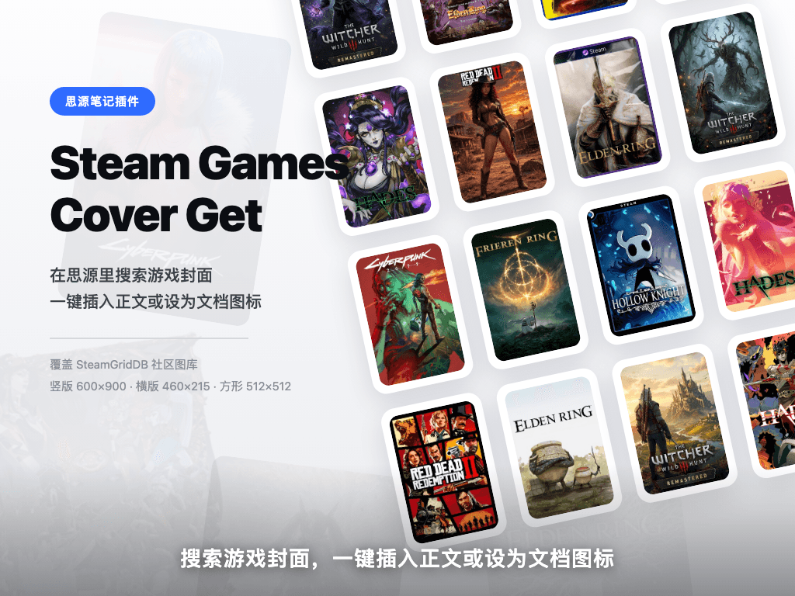

# Steam Games Cover Get

A SiYuan note plugin. Search game cover art on [SteamGridDB](https://www.steamgriddb.com/),
insert it into your notes, or set it as the document icon.

## Set up your API key first

SteamGridDB requires authentication on every endpoint — there is no anonymous access,
so you need your own free key. Four steps:

1. Open https://www.steamgriddb.com/ and sign in with a Steam account or email
2. Go to https://www.steamgriddb.com/profile/preferences/api
   (or use the avatar menu in the top-right → Preferences → API)
3. Find the API Key section on that page, generate one and copy the whole string
4. In SiYuan → Settings → Third-party plugins → Steam Games Cover Get → paste → save

The key is stored only in your local workspace data. It is never sent anywhere else.

## How to use

Entries live in the top bar, breadcrumbs and the emoji panel. Hotkey: `⌥⌘G`.

Open the panel, type a game name and press Enter. Once results show up:

- Left-click a cover → insert at the cursor
- Hover the button in the card's top-right corner → set as document icon
- Right-click → both options

## About cover sizes

The default is `600x900` portrait, best for covers and document icons. The chips at the
top of the panel switch to hero (460×215) and square (512×512).

SteamGridDB is a community library: the same game often has dozens of covers in different
styles, ranked by score — the top ones are usually the good ones.

## Data source

All covers come from [SteamGridDB](https://www.steamgriddb.com/) and belong to their
uploaders and the original game publishers. This plugin only searches and inserts them;
it does not store or redistribute these images.
